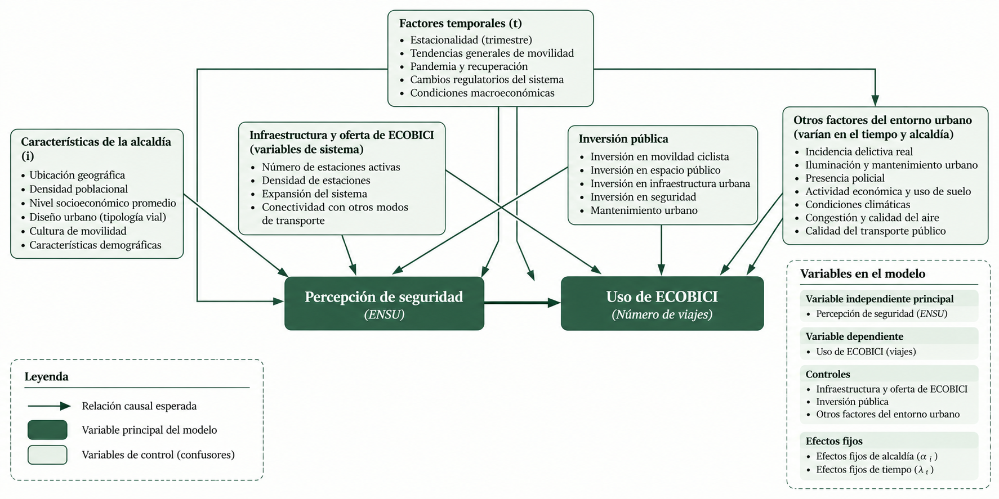

# ECOBICI y percepción de seguridad en la Ciudad de México

### Proyecto de investigación | Análisis de datos e inferencia econométrica

Este repositorio reúne las fuentes de información, notebooks de procesamiento, conjuntos de datos derivados y procedimientos de análisis desarrollados para estudiar la **relación entre la percepción de inseguridad y el uso del sistema ECOBICI en la Ciudad de México**.

La investigación integra registros administrativos de viajes de ECOBICI, indicadores de la **Encuesta Nacional de Seguridad Pública Urbana (ENSU)** y datos de **inversión pública** del Instituto Nacional de Estadística y Geografía (INEGI). El análisis se desarrolla mediante un panel de alcaldías observado a lo largo del tiempo.

> **Alcance:** el proyecto busca evaluar la relación entre seguridad percibida y uso de la bicicleta pública. Una estimación con efectos fijos no demuestra, por sí sola, un efecto causal: la interpretación depende de los supuestos de identificación y de la calidad de los datos.

## 1. Pregunta de investigación

**¿Qué relación existe entre la percepción de inseguridad de la población y la utilización del sistema ECOBICI en las alcaldías de la Ciudad de México?**

El proyecto busca identificar patrones temporales y territoriales en el número de viajes y determinar si la percepción de inseguridad presenta una asociación estadística con el uso del sistema, considerando diferencias persistentes entre alcaldías, cambios comunes a lo largo del tiempo y controles observables.

### Alcance territorial

El análisis de ECOBICI considera seis alcaldías:

- Álvaro Obregón
- Azcapotzalco
- Benito Juárez
- Coyoacán
- Cuauhtémoc
- Miguel Hidalgo

Las fuentes auxiliares de ENSU e inversión pública contienen información de las **16 alcaldías**; para el modelo se seleccionan y armonizan las observaciones pertinentes a la cobertura analizada.

### Periodo de referencia

Los archivos procesados de ECOBICI y ENSU contienen registros de **2020 a 2026** (con cobertura parcial en 2026). La base procesada de inversión pública incluye **2020–2025**. La muestra efectiva de cada regresión puede ser menor según la disponibilidad de variables y los filtros empleados.

## 2. Estructura del repositorio

```text
casoEcobici/
├── dataIngestion/
│   ├── LecturaEcobici.ipynb
│   ├── MapeoAlcaldias.ipynb
│   ├── LecturaDatosENSU.ipynb
│   ├── LecturadeDatosInversionPublica.ipynb
│   └── MapasdeSeguridad.ipynb
├── artefactos/
│   ├── catalogo_ecobici_estaciones_alcaldia.csv
│   ├── ecobici_estaciones_por_alcaldia_resumen.csv
│   ├── ecobici_resumen_viajes_trimestre_alcaldia.csv
│   ├── ecobici_resumen_viajes_trimestre_alcaldia.xlsx
│   ├── percepcion_seguridad_alcaldias_cdmx.csv
│   └── inversion_publica_alcaldia.csv
├── ensu/
│   └── [tabulados originales ENSU, organizados por periodo]
├── finanzas_publicas/
│   └── [archivos originales de finanzas públicas del INEGI]
├── [ubicación del notebook Experimento(1).ipynb por confirmar]
├── [ubicación del notebook GráficasDeAnalisis.ipynb por confirmar]
└── README.md
```
## 3. Fuentes de información

| Fuente | Información utilizada | Frecuencia de análisis | Función en el proyecto |
|---|---|---|---|
| **ECOBICI** | Viajes registrados y estaciones de retiro; identificación geográfica de estaciones | Trimestral | Medición del uso del sistema y de la infraestructura operativa |
| **ENSU — INEGI** | Población de 18 años y más y porcentajes de percepción de seguridad/inseguridad | Trimestral, sujeto a disponibilidad | Variable explicativa de interés |
| **Finanzas públicas — INEGI** | Monto de inversión pública por alcaldía | Anual | Variable de control en algunas especificaciones |

### 3.1 ECOBICI

Se utilizan registros históricos de viajes publicados por el sistema ECOBICI. El procesamiento contempla diferencias de formato entre archivos, transformación de los datos y agregación por **año, trimestre, estación de retiro, alcaldía y género**.

La asignación de estaciones a alcaldías se apoya en información geográfica de estaciones y polígonos territoriales. Los identificadores históricos deben revisarse al cruzarse con el catálogo de estaciones.

### 3.2 Encuesta Nacional de Seguridad Pública Urbana (ENSU)

Los paquetes de tabulados básicos de la ENSU contienen distintos conjuntos de tablas por levantamiento. La fuente de la variable de interés se procesa mediante `LecturaDatosENSU.ipynb`.

**Nota de reproducibilidad importante:** aunque se identificó inicialmente el archivo `II_sensacion_seguridad_...` como tabulado de interés, el notebook entregado **lee información de la sección I, hoja `1.7`**. Para reproducir exactamente `percepcion_seguridad_alcaldias_cdmx.csv` deben conservarse los archivos efectivamente utilizados por el notebook, y no únicamente los del módulo II. Es necesario conciliar esta diferencia antes de declarar completamente reproducible el flujo de ENSU.

### 3.3 Finanzas públicas

Los archivos de origen provienen de las estadísticas de finanzas públicas del INEGI. `LecturadeDatosInversionPublica.ipynb` limpia y consolida montos anuales por alcaldía.

La inversión pública corresponde a una categoría agregada de gasto y **no debe interpretarse automáticamente como inversión en ciclovías, ECOBICI o movilidad ciclista**.

## 4. Notebooks y flujo de procesamiento

| Notebook | Etapa | Descripción |
|---|---|---|
| `dataIngestion/MapeoAlcaldias.ipynb` | Georreferenciación | Asigna estaciones ECOBICI a alcaldías mediante coordenadas y límites geográficos. |
| `dataIngestion/LecturaEcobici.ipynb` | Extracción y transformación | Consulta archivos históricos de viajes, procesa datos intermedios (incluido Parquet) y construye agregados trimestrales. |
| `dataIngestion/LecturaDatosENSU.ipynb` | Integración ENSU | Extrae indicadores y construye la base trimestral de percepción de seguridad por alcaldía. |
| `dataIngestion/LecturadeDatosInversionPublica.ipynb` | Integración financiera | Limpia y consolida los montos de inversión pública por alcaldía y año. |
| `dataIngestion/MapasdeSeguridad.ipynb` | Visualización espacial | Explora la distribución geográfica de los indicadores de seguridad. |
| `GráficasDeAnalisis.ipynb` | Análisis exploratorio | Compara viajes, percepción de seguridad y correlaciones a lo largo del tiempo. |
| `Experimento(1).ipynb` | Modelado econométrico | Integra el panel y estima modelos de regresión con efectos fijos, además de producir diagnósticos y gráficas. | 

### Flujo de datos


```text
Registros históricos ECOBICI ──> LecturaEcobici ────────────┐
Catálogo y geografía ────────> MapeoAlcaldias ──────────────┤
Tabulados ENSU ───────────────> LecturaDatosENSU ────────────┼──> Panel alcaldía × trimestre
Finanzas públicas INEGI ─────> LecturadeDatosInversionPublica ┘             │
                                                                            ├──> Análisis exploratorio
                                                                            └──> Modelo econométrico
```

Este esquema representa las dependencias conceptuales; los notebooks pueden requerir ajustes de rutas y ejecución según los archivos intermedios que ya estén disponibles.

## 5. Diccionario de artefactos

Los archivos de la carpeta `artefactos/` son **datos derivados del procesamiento**, no sustitutos de las fuentes originales.

### `catalogo_ecobici_estaciones_alcaldia.csv`

**677 filas.** Contiene las columnas:

| Campo | Descripción |
|---|---|
| `station_id` | Identificador de la estación |
| `name` | Nombre de la estación |
| `short_name` | Nombre o identificador corto |
| `alcaldia` | Alcaldía asignada a la estación |

### `ecobici_estaciones_por_alcaldia_resumen.csv`

**6 filas.** Columnas: `alcaldia`, `num_estaciones`. Resume las estaciones presentes en el catálogo por alcaldía.

### `ecobici_resumen_viajes_trimestre_alcaldia.csv`

**46,091 filas.** Columnas:

| Campo | Descripción |
|---|---|
| `anio` | Año de observación |
| `trimestre` | Trimestre de observación |
| `ciclo_estacion_retiro` | Identificador de estación de retiro |
| `alcaldia` | Alcaldía asociada a la estación, o categoría sin correspondencia |
| `genero` | Categoría de género registrada |
| `n_viajes` | Número de viajes en la agregación |
| `estaciones_activas_alcaldia` | Número de estaciones activas atribuido a la alcaldía |

Los registros incluyen la categoría territorial **`SIN_CATALOGO`** y categorías de género **`F`, `M`, `O` y `?`**. Se deben tratar explícitamente al generar las bases analíticas y las desagregaciones.

`ecobici_resumen_viajes_trimestre_alcaldia.xlsx` contiene la versión Excel de la misma estructura tabular para consulta.

### `percepcion_seguridad_alcaldias_cdmx.csv`

**400 filas, 16 alcaldías, 2020–2026.** Columnas:

| Campo | Descripción |
|---|---|
| `anio`, `mes`, `trimestre` | Identificadores temporales |
| `region`, `alcaldia` | Identificadores territoriales |
| `poblacion_18mas` | Población de referencia de 18 años y más |
| `seguro_abs`, `seguro_pct` | Conteo y porcentaje correspondiente a percepción de seguridad |
| `inseguro_abs`, `inseguro_pct` | Conteo y porcentaje correspondiente a percepción de inseguridad |

La base contiene **tres trimestres de 2020**, **cuatro por año entre 2021 y 2025**, y **dos trimestres de 2026**. La cobertura debe verificarse al integrar el panel; no debe asumirse que todos los periodos están presentes.

### `inversion_publica_alcaldia.csv`

**96 filas, 16 alcaldías, 2020–2025.** Columnas: `año`, `alcaldia`, `inversion_publica`. La variable representa el monto anual reportado en los datos procesados; antes de compararlo económicamente a través del tiempo conviene revisar unidades monetarias, tratamiento de inflación y posibles cambios de clasificación de la fuente.

## 6. Estrategia econométrica

 Diagrama causal


  
La unidad principal de observación es la **alcaldía–trimestre**. El notebook `Experimento(1).ipynb` implementa regresiones de panel de **efectos fijos por alcaldía y por periodo**.


Una especificación considerada en el proyecto es:

$$
\begin{aligned}
\log(1+\mathrm{Viajes}_{it}) = {}&
\beta_1\mathrm{Inseguridad}_{it} \\
&+\beta_2\mathrm{Estaciones}_{it} \\
&+\beta_3\log(1+\mathrm{Inversión}_{it}) \\
&+\alpha_i+\gamma_t+\varepsilon_{it}
\end{aligned}
$$

Donde:

- $i$ identifica la alcaldía y $t$ el trimestre.
- $\mathrm{Viajes}_{it}$ es el total de viajes agregados para la unidad territorial y temporal.
- $\mathrm{Inseguridad}_{it}$ es el porcentaje de percepción de inseguridad derivado de ENSU.
- $\mathrm{Estaciones}_{it}$ mide las estaciones activas en la alcaldía.
- $\mathrm{Inversión}_{it}$ es el control de inversión pública, presente solo en las especificaciones que lo incluyen.
- $\alpha_i$ representa los efectos fijos de alcaldía y $\gamma_t$ los efectos fijos temporales.
- $\varepsilon_{it}$ representa el término de error.

El notebook contempla especificaciones **con y sin inversión pública**, además de análisis agregados y desagregados por género. Incluye comparaciones de coeficientes, intervalos de confianza y ejercicios de diagnóstico, como la comparación entre efectos fijos y aleatorios.


## 6. Cómo ejecutar el proyecto

Los notebooks fueron desarrollados para **Python en Google Colab** y varios utilizan archivos alojados en **Google Drive**. Para reproducirlos:

1. Descargar o clonar este repositorio y organizar los archivos originales según las rutas esperadas por cada notebook.
2. Abrir los notebooks de `dataIngestion/` en Google Colab.
3. Montar Google Drive si el notebook lo requiere y **modificar las rutas absolutas** para que correspondan a la ubicación local de los archivos.
4. Instalar las dependencias requeridas por el notebook en cuestión. Entre las bibliotecas identificadas están `pandas`, `requests`, `geopandas`, `matplotlib` y `linearmodels`, además de los lectores de Excel/Parquet que correspondan.
5. Ejecutar primero las etapas de mapeo y lectura de las fuentes, verificando la generación de los archivos de `artefactos/`.
6. Revisar las correspondencias territoriales y temporales, ejecutar el análisis exploratorio y finalmente el notebook econométrico.

## 7. Fuentes y referencias institucionales

- **ECOBICI:** registros históricos y datos abiertos del sistema de bicicletas públicas de la Ciudad de México.
- **INEGI — ENSU:** Encuesta Nacional de Seguridad Pública Urbana, tabulados básicos históricos.
- **INEGI — Finanzas públicas:** estadísticas de finanzas públicas estatales y municipales / demarcaciones territoriales de la Ciudad de México.
## 8. Uso de inteligencia artificial y transparencia metodológica
  
  - Durante el desarrollo de este proyecto se utilizaron herramientas de inteligencia artificial generativa, particularmente ChatGPT y Claude.ia como apoyo en distintas etapas del proceso de investigación y desarrollo computacional.
  - Su utilización se concentró principalmente en las siguientes actividades:
  - Procesamiento de datos: apoyo en la identificación de inconsistencias, homologación de estructuras de información y construcción de bases de datos para el análisis.
  - Visualización de información: apoyo en la construcción y mejora de gráficas, mapas y representaciones de resultados estadísticos.
  - Documentación técnica: asistencia en la elaboración de descripciones metodológicas, comentarios de código y documentación del repositorio.

  **Responsabilidad sobre la investigación**

  La inteligencia artificial se utilizó como una herramienta de asistencia técnica y conceptual, no como sustituto del criterio científico.
  
  La definición del problema de investigación, selección de fuentes de información, planteamiento de hipótesis, decisiones metodológicas e interpretación final de   los hallazgos permanecen bajo responsabilidad de la autora del proyecto.
  Para usar este repositorio en investigaciones posteriores, se recomienda consultar la documentación oficial y las notas metodológicas de cada fuente,       especialmente ante cambios en cobertura, definiciones o procedimientos de estimación.

---

**Estado del proyecto:** investigación de titulación en desarrollo. Los datos y los modelos están sujetos a revisión y actualización.
